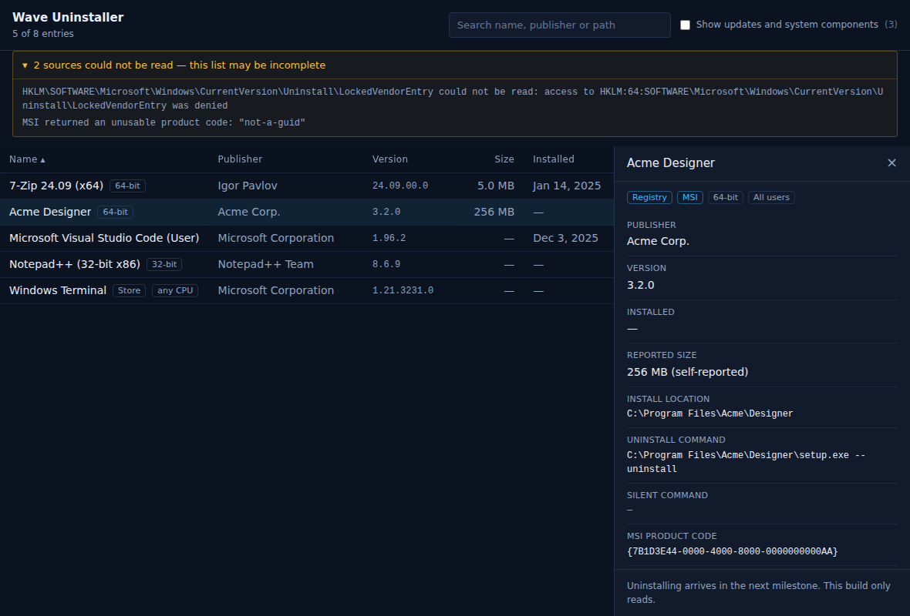

# Wave Uninstaller

Ein Uninstaller für Windows, der nicht nur das Programm entfernt, sondern auch
die Reste: verwaiste Registry-Schlüssel, zurückgelassene Ordner in `AppData` und
`ProgramData`, Dienste, geplante Tasks, Autostart-Einträge und Verknüpfungen.

Vorbild ist Revo Uninstaller — mit dem Unterschied, dass **jede** Löschung erst
in ein Backup wandert und vollständig rückgängig gemacht werden kann.

Die technische Planung steht in [`PLAN.md`](./PLAN.md).

## Status

**Phase P0 von 5.** Wave liest das Inventar und zeigt es an. Es deinstalliert
nichts und löscht nichts — das kommt in P1 und P2, sobald es in P3 ein
funktionierendes Undo dafür gibt.

Was schon steht:

- Inventar aus Registry-Uninstall-Keys (beide Registry-Sichten), MSI-Datenbank
  und Store-/MSIX-Paketen
- Zusammenführung der drei Quellen zu einer Zeile pro Programm
- Read-only-UI mit Suche, Sortierung und Detailansicht
- Testbarkeit des Kerns ohne Windows



> Der Screenshot zeigt die erfundene Maschine aus
> `crates/wave-core/tests/fixtures/typical_machine.json`, nicht ein echtes
> System.

## Aufbau

```
crates/wave-core    Was ist installiert, was gehört zusammen — kennt kein Windows
crates/wave-win32   Registry, MSI, MSIX — kennt keine Entscheidungen
src-tauri           Tauri-Shell und die Commands, die die UI aufruft
src                 React + TypeScript + Tailwind
```

Der Kern greift nie direkt auf Win32 zu, sondern nur über das Trait
`SystemProvider`. Davon gibt es zwei Implementierungen: die echte in
`wave-win32` und eine, die einen erfundenen Registry- und Dateisystem-Zustand
aus JSON liest.

Das ist keine Architektur-Kosmetik. Die Logik, die entscheidet, welche Dateien
gelöscht werden dürfen, muss testbar sein — und zwar deterministisch, in
Sekunden, ohne VM. Ein Uninstaller, dessen Entscheidungslogik man nur manuell
in einer virtuellen Maschine ausprobieren kann, wird nie vertrauenswürdig.

## Entwickeln

Voraussetzungen: Rust (stable, ≥ 1.82), Node 22, und für die App die
[Tauri-Systemabhängigkeiten](https://v2.tauri.app/start/prerequisites/).

```bash
npm install
npm run tauri dev      # die App (nur unter Windows sinnvoll)
```

Kern testen — geht auf jedem Betriebssystem:

```bash
cargo test -p wave-core
```

Den Windows-Layer prüfen, ohne Windows zu haben:

```bash
rustup target add x86_64-pc-windows-msvc
cargo clippy -p wave-win32 --target x86_64-pc-windows-msvc -- -D warnings
```

Das findet Fehler in den Win32-Aufrufen, weil gegen die echten Bindings
typgeprüft wird. Nur das Linken braucht einen Windows-Host.

Sehen, was eine Fixture ergibt:

```bash
cargo run -p wave-core --example dump-inventory -- \
  crates/wave-core/tests/fixtures/typical_machine.json
```

Unter Linux baut nur der Kern. `wave-app` braucht eine WebView und
`wave-win32` ist vollständig `#[cfg(windows)]` — beides deckt der
Windows-Job in CI ab.

## Lizenz

Noch nicht festgelegt.
